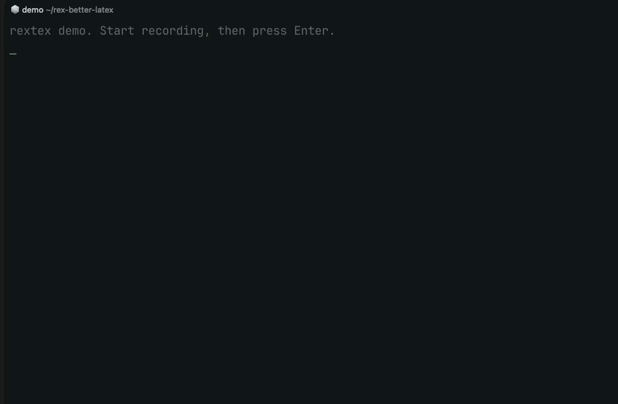

<p align="center">
  
</p>

<h1 align="center">rextex</h1>

<p align="center">
  See LaTeX formulas as real, typeset math in <a href="https://www.superlogical.com/rex/docs">Rex</a> terminal panes.
</p>

<p align="center">
  <a href="LICENSE"></a>
  
  
</p>

<p align="center">
  English · <a href="README.zh-CN.md">中文</a>
</p>

<p align="center">
  
</p>

In a terminal, a formula is usually just its source, such as `$\frac{n(n+1)}{2}$`. rextex reads the text on a pane's screen, finds the formulas, typesets them with MathJax, and draws each one as an image over its own source. No TeX installation is needed.

> [!NOTE]
> rextex is an unofficial plugin, not affiliated with Superlogical. Rex is in beta and its interfaces may change.

## Features

| | |
| --- | --- |
| **Render in place** | Each formula is drawn over its own source, in the pane where it appears, and follows the screen as it changes. |
| **Formula pane** | A second pane lists the formulas at a larger size, with scrolling, zoom, and copy. |
| **Files** | Follow a `.tex` or `.md` file and see its formulas update when you save. |
| **Writing skill** | A Claude Code skill makes the agent lay out math so it has room to be drawn. |

## Contents

- [Install](#install)
- [Use](#use)
- [What it recognizes](#what-it-recognizes)
- [Configure](#configure)
- [Limits](#limits)
- [Develop](#develop)
- [Credits and license](#credits-and-license)

## Install

rextex needs Node.js 18 or later and Rex on macOS or Linux.

```sh
git clone https://github.com/shinmohuang/rextex.git
cd rextex
./install.sh                 # install, bound to cmd+shift+m
./install.sh --key cmd+e     # use another key
./install.sh --no-config     # leave init.lua alone and add the line yourself
./install.sh --uninstall     # remove everything the script added
```

<details>
<summary>What the install script changes</summary>

- It writes a launcher at `~/.local/bin/rextex`.
- It links `rex/rextex.lua` to `~/.config/rex/rextex.lua`.
- It appends a marked block to `~/.config/rex/init.lua`, after saving the original as `init.lua.rextex-backup`.
- If `~/.claude` exists, it links the writing skill to `~/.claude/skills/rextex-math`. The skill tells Claude Code how to lay out formula source, for example a display formula on three lines with a blank line before and after, so that in-place rendering has enough rows to draw in. Only new conversations load it.

</details>

> [!TIP]
> Run `./install.sh` again after you move this folder or change your Node version.

## Use

### Render in place

Focus a pane that shows formulas and press `cmd+shift+m`, or search the command palette for "LaTeX: Render Formulas in Place". Each formula is drawn over its own source and follows the screen as it changes. Press the key again to see the source.

- Inline math keeps to its one row. A display formula also uses the blank rows above and below it, so it can be drawn larger.
- A formula that doesn't fit, such as a tall fraction on a single row, stays as source. So does one that is unfinished or has a syntax error.
- The colors come from your terminal theme. The first time you use it, a small split flashes open to measure them. After you change the theme, run `rextex theme` in any pane to measure again. If a formula still shows a faint box around it, Rex is drawing its background in a different shade from the one it reports; set the shade by hand with `rextex theme --bg '#RRGGBB'`.

### List formulas in a second pane

Search the command palette for "LaTeX: Show Formulas in This Pane". A pane opens on the right that lists the formulas at a larger size. To bind a key to it, set `preview_key` in the configuration.

Keys in that pane:

| Key | Action |
| --- | --- |
| `j` / `k`, arrow keys, mouse wheel | Scroll |
| Space / `b`, `d` / `u` | Page / half page |
| `g` / `G` | Top / end (at the end, the list follows new formulas) |
| `+` / `-` / `0` | Zoom in / zoom out / reset |
| `y` | Copy the LaTeX source of the formula at the top |
| `c` | Clear the list |
| `q` | Quit |

While the pane follows another pane, a formula stays in the list after it scrolls off the screen.

### Command line

```sh
rextex inline --block BLOCK           # render in place in a pane (--on / --off)
rextex view paper.tex                 # follow a file, in this pane
rextex view --block BLOCK             # follow another pane
rextex show '\int_0^1 x^2\,dx'        # draw a formula right here
rextex list paper.tex                 # print the formulas found, as text
```

## What it recognizes

rextex finds math between `$…$`, `$$…$$`, `\(…\)`, and `\[…\]`, and in environments such as `equation`, `align`, `gather`, `multline`, `cases`, and the `matrix` family. When listing formulas, it rejoins one that the terminal broke across lines.

`$…$` also appears in shell text and prices, so it counts as a formula only when its content reads as math. `$5 and $10` and `"$HOME"` are skipped.

## Configure

The install script adds this line to `init.lua`. Pass more options to change the defaults:

```lua
require("rextex").setup{ key = "cmd+shift+m" }
```

| Option | Default | Description |
| --- | --- | --- |
| `key` | none | Key for in-place rendering. Without it, the action is in the command palette only. |
| `preview_key` | none | Key for the formula pane. |
| `inline_zoom` | `1` | Formula size for in-place rendering. |
| `where` | `"right"` | Where the formula pane opens: `"right"`, `"below"`, or `"float"`. |
| `ratio` | `0.4` | Share of the space the formula pane gets. |
| `zoom` | `1.3` | Formula size in the formula pane, relative to the text. |
| `bin` | `~/.local/bin/rextex` | Path to the `rextex` command. |

## Limits

- The terminal must support the kitty graphics protocol. Rex does.
- In-place rendering can't move text. A formula gets the rows its source occupies, plus neighboring blank rows for display math. The `rextex-math` skill exists to make Claude Code leave enough room.
- In-place rendering runs on the machine the session runs on. For a session on a remote host, install rextex on that host.
- rextex draws math, not whole documents. It doesn't see macros defined with `\newcommand` outside a formula, and a formula that uses one is reported as an error.
- In the formula pane, a formula with a syntax error shows the error message in place of an image.
- If a program shows `\[` as `[`, as some Markdown renderers do when they remove backslashes, no delimiter is left on screen to recognize.

## Develop

```sh
npm install
npm test
```

## Credits and license

The technique for in-place rendering, writing kitty graphics to the pane's tty device, comes from [liambern/herdr-math](https://github.com/liambern/herdr-math). Formulas are typeset with [MathJax](https://www.mathjax.org) and rasterized with [resvg-js](https://github.com/yisibl/resvg-js).

[MIT](LICENSE)
